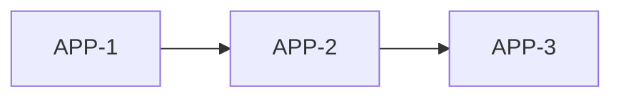

# Plan agentique — gestionnaire de tickets local pour agents de développement

Application **locale** de type Jira minimaliste, conçue pour documenter des plans de développement et les faire exécuter par des agents IA via **MCP**.

Le principe : un ticket n'est pas une note pour humains, c'est un **contrat de travail lisible par un agent**. Il contient tout ce dont un agent, sans contexte préalable, a besoin pour exécuter une étape et prouver qu'elle est terminée.

---

## Concepts

### Hiérarchie fixe à trois niveaux

```
Projet
└── Ticket (= une feature)
    └── Sous-ticket (= une étape de la feature)
```

- Un **projet** regroupe tout ce qui concerne un produit ou un dépôt. L'application gère plusieurs projets de types différents.
- Un **ticket** correspond à une feature.
- Un **sous-ticket** correspond à une étape de cette feature. C'est l'unité de travail que les agents réclament.
- La profondeur est volontairement limitée : pas de sous-sous-tickets.

### Types de projet (gabarits)

Chaque projet a un type (application web, micro-SaaS, pipeline de données, etc.) qui sert de gabarit :

- **Contexte** : chemin du dépôt, stack, branche principale, conventions git.
- **Étapes par défaut** : points de départ pour décomposer une feature.
- **Vérifications** : commandes nommées (`test`, `lint`, `typecheck`, `build`…) propres au projet.

### Dépendances

- Les liens de dépendance (`bloque` / `bloqué par`) existent **entre tickets** et **entre sous-tickets**.
- Ils sont **internes à un projet** : aucune dépendance ne traverse les projets.
- Une dépendance entre sous-tickets est limitée aux étapes d'un même ticket.
- Les cycles sont détectés et refusés à la création.
- Une dépendance entre tickets est satisfaite quand le ticket bloquant est `done` (validé par l'humain).
- Pour mentionner un élément d'un autre projet, on utilise une simple **référence externe** (lien texte, non bloquant) dans le contexte du ticket.

---

## Cycle de vie

### Statuts d'un sous-ticket

| Statut | Signification |
|---|---|
| `proposed` | Créé par un agent, en attente de validation humaine |
| `todo` | Validé, pas encore pris |
| `in_progress` | Réclamé par un agent (avec bail) |
| `needs_input` | L'agent a une question, ou aucune vérification n'est associée |
| `review` | Étape à revue obligatoire (`requires_review`) : vérifications réussies, en attente de validation humaine |
| `done` | Vérifications réussies |
| `failed` | Trop d'échecs, triage humain requis |
| `cancelled` | Abandonné |

L'état **`ready`** n'est pas stocké : une étape est prête si elle est `todo` et que toutes ses dépendances sont `done`.

### Statut et phase d'un ticket

Le statut stocké est `proposed`, `open`, `done` ou `cancelled`. Pour un ticket `open`, une **phase** est dérivée de ses sous-tickets :

- une étape `failed`, `needs_input` ou `review` → phase `needs_attention` ;
- toutes les étapes non annulées sont `done`, avec au moins une étape non annulée → phase `review` ;
- au moins une étape est `in_progress` ou `done` → phase `in_progress` ;
- sinon → phase `todo`.

Une étape `proposed` compte comme non terminée et empêche la phase `review`. Seul l'humain peut faire passer un ticket `open`, en phase `review`, à `done`.

### Validation humaine : au niveau de la feature

Les agents enchaînent les étapes dont les vérifications passent, sans validation intermédiaire. L'humain valide **la feature complète** à la fin.

Exception : une étape peut porter le drapeau `requires_review` (migration de schéma, suppression de données, changement d'authentification) pour forcer une pause humaine.

---

## Fonctionnement

### Création des tickets : deux modes

1. **Manuelle** : tu écris la feature et ses étapes. Le ticket démarre en `open` et ses étapes en `todo`.
2. **Par un agent planificateur** : il décompose une feature en étapes via MCP. Tout ce qu'il crée arrive en `proposed`, invisible pour les agents d'exécution tant que tu ne l'as pas validé (accepter, modifier ou rejeter, par ticket ou en bloc).

Chaque ticket porte un champ `origin` (`human` ou `agent`).

### Exécution par les agents

1. L'agent **réclame** la prochaine étape prête (`claim_step`). La réclamation est un **bail** (durée configurable, environ 30 minutes par défaut), renouvelé à chaque appel de l'agent portant sur cette étape.
2. La réponse contient déjà tout le contexte : projet, feature parente, étape, dépendances, notes de passation, conventions git, vérifications disponibles.
3. Il travaille dans son worktree git, sur la branche de la feature, et fait un commit par étape.
4. Il appelle `complete_step(step, commit_sha, worktree_path, branch)`.
5. **L'application exécute elle-même les vérifications** (voir plus bas). Si tout passe, l'étape est `done` ou `review` si elle exige une revue ; sinon, l'agent reçoit la sortie d'erreur et l'étape reste `in_progress`.

### Gestion des échecs

| Situation | Comportement |
|---|---|
| L'agent disparaît | Le bail expire, l'étape retourne à `todo`, compteur de tentatives +1, note automatique |
| L'agent abandonne | `pause_step(kind=release, message)` : retour à `todo`, la raison devient une note pour le prochain agent |
| Spécification floue | `pause_step(kind=question, message)` : passage en `needs_input`, ta réponse est ajoutée en note |
| Vérifications en échec | L'étape ne se ferme pas, l'agent reçoit la sortie d'erreur |
| Boucle d'échecs | Après N tentatives (ex. 3), l'étape passe en `failed` et n'est plus réessayée automatiquement |

Sur une étape `failed`, tu peux : réessayer, modifier, découper ou annuler.

### Vérifications exécutées par l'application

L'agent ne déclare pas « les tests passent » : c'est l'application qui le constate.

- Les vérifications sont **définies au niveau du projet** (ou du gabarit) avec leur commande, répertoire de travail, délai maximal et code de sortie attendu.
- Les tickets et étapes ne **référencent que des noms** de vérifications. Un agent ne peut pas injecter de commande arbitraire.
- L'application exécute les commandes dans le worktree de la feature, après avoir confirmé que le HEAD correspond au SHA fourni.
- Chaque exécution est conservée (étape, vérification, SHA, code de sortie, durée, sortie tronquée).
- Une étape sans vérification associée ne se ferme jamais automatiquement : elle passe en `needs_input`.

### Git : géré par l'agent

L'application **ne pilote pas git**. Elle stocke :

- au niveau **projet** : les conventions de branches et de commits (ex. `feature/<clé-ticket>-slug`, un commit par étape avec la clé de l'étape dans le message), le chemin du dépôt, la branche principale ;
- au niveau **ticket** : le nom de la branche ;
- au niveau **étape** : le SHA du commit.

Pour permettre plusieurs agents en parallèle sur un même dépôt, la convention est d'utiliser **un git worktree par feature**. L'agent communique la branche et le chemin du worktree via `complete_step`.

### Revue de feature (écran central)

Quand toutes les étapes non annulées sont `done` (et qu'il y en a au moins une), la feature est en phase `review`. L'écran de revue affiche :

- le résumé de la feature et la liste des étapes avec leurs résultats de vérification ;
- le diff de la branche, par étape grâce aux commits (lecture seule) ;
- le journal d'événements : échecs, reprises, questions posées.

Actions possibles :

- **Valider** : la feature passe en `done` (tu fusionnes la branche).
- **Rejeter de façon ciblée** : tu choisis les étapes à rouvrir ; les étapes dépendantes `done` en aval se rouvrent aussi. Ton commentaire devient la note de passation. L'application ne modifie pas git ; l'agent prépare lui-même son worktree pour reprendre le travail.
- **Rejeter en bloc**.

### Journal d'événements

Chaque transition est écrite dans une table `events` (qui, quand, pourquoi). Il sert d'audit et de mémoire de passation entre agents.

---

## Export du plan : PLAN.md

L'application peut générer un fichier **PLAN.md** : une vue Markdown standard du plan, lisible par un humain comme par n'importe quel agent, sans passer par MCP.

### Principes

- **Export à sens unique** : la base de données reste la source de vérité. Modifier PLAN.md à la main n'a aucun effet (l'en-tête du fichier le rappelle).
- **Sortie déterministe** : mêmes données, même fichier, octet pour octet (tri stable : tickets par clé, étapes par ordre). Les diffs git restent propres et lisibles.
- **Clés stables** : chaque ticket et chaque étape a une clé lisible (`APP-3`, `APP-3.2`) qui ne change jamais. Ce sont les mêmes clés que dans les noms de branche et les messages de commit.
- Les éléments `proposed` sont inclus, mais clairement marqués.

### Portée et options

| Option | Effet |
|---|---|
| Portée | Projet complet (par défaut) ou une seule feature |
| Filtre de statuts | Par exemple, seulement les tickets ouverts |
| Graphe | Ajoute un diagramme Mermaid des dépendances |
| Notes | Inclut les notes de passation (exclues par défaut) |

### Déclenchement et destination

- Bouton « Exporter » sur l'écran du projet ou du ticket, ou commande locale (`npm run export-plan -- <projet>`).
- Option par projet : ré-export automatique à chaque changement de statut.
- **Destination par défaut : le dossier d'exports de l'application**, hors du dépôt du projet. Écrire PLAN.md dans le dépôt est une option explicite : cela modifie l'arbre de travail, et l'application ne fait aucune opération git, donc le commit du fichier reste à la charge de l'humain ou de l'agent.
- Ce n'est **pas** un outil MCP : la surface reste à 6 outils. Un agent qui a accès au fichier peut simplement le lire.

### Format

````markdown
# Plan — Mon projet

> Révision 128 · Type : application web
> Source de vérité : l'application (ne pas éditer à la main)

## Vue d'ensemble

| Clé | Feature | Statut / phase | Étapes | Dépend de |
|---|---|---|---|---|
| APP-1 | Authentification | `done` | 4/4 | — |
| APP-2 | Tableau de bord | `in_progress` | 1/3 | APP-1 |
| APP-3 | Export CSV | `proposed` | 0/2 | APP-2 |

## Graphe des dépendances



## APP-2 · Tableau de bord

- **Phase** : `in_progress`
- **Branche** : `feature/APP-2-tableau-de-bord`
- **Dépend de** : APP-1
- **Origine** : agent

Description de la feature.

### Étapes

- [x] **APP-2.1** Schéma de données — `done` · commit `a1b2c3d`
- [ ] **APP-2.2** API des agrégats — `in_progress` · dépend de APP-2.1 · vérifications : `test`, `typecheck`
  - Critères d'acceptation : …
- [ ] **APP-2.3** Interface — `todo` · dépend de APP-2.2 · revue obligatoire
````

---

## Interface agents : MCP

### Pourquoi MCP, et pourquoi si peu d'outils

MCP injecte les schémas de tous ses outils dans le contexte de l'agent à chaque tour. Pour éviter ce coût, la surface d'outils est **volontairement minuscule : 6 outils**. En contrepartie, MCP offre une intégration native dans les clients compatibles et une interface contrôlée (l'agent n'a jamais accès directement à la base).

La logique métier vit dans un **noyau partagé**. MCP en est une façade ; un CLI mince (`plan claim`, `plan complete`…) pourra s'y ajouter plus tard sans toucher au noyau.

### Les 6 outils

| Outil | Rôle |
|---|---|
| `get_overview(project?, detail?)` | Vue compacte : étapes prêtes, en cours, à traiter, plus conventions et vérifications du projet |
| `claim_step(project?, step?)` | Sans `step`, prend la prochaine étape prête. Renvoie un **paquet complet** : étape, feature, dépendances, notes, conventions git |
| `complete_step(step, commit_sha, worktree_path, branch?)` | L'application lance les vérifications ; renvoie le succès ou la sortie d'erreur |
| `pause_step(step, kind, message)` | `kind` = `release` (abandon, la raison devient une note) ou `question` (passage en `needs_input`) |
| `add_note(target, text)` | Note de passation sur un ticket ou une étape |
| `propose_plan(project, ticket, steps[], deps[])` | Crée feature, étapes et dépendances **en une seule transaction**, en `proposed`, avec rejet des cycles |

Le bail d'une étape est renouvelé implicitement par tout appel portant sur cette étape : pas d'outil de battement de cœur.

### Deux profils

Le serveur MCP s'expose en deux profils, pour que chaque agent ne charge que ce dont il a besoin :

- **Exécuteur** : `claim_step`, `complete_step`, `pause_step`, `add_note`
- **Planificateur** : `get_overview`, `propose_plan`, `add_note`

C'est aussi une barrière de sécurité : un exécuteur ne peut pas créer de plan, un planificateur ne peut pas réclamer d'étape.

### Principes de conception des réponses

- Réponses **compactes et structurées**, avec la prochaine action suggérée.
- Erreurs qui disent quoi faire (« étape non prête : bloquée par l'étape X »).
- Le protocole de travail des agents vit dans un court fichier d'instructions (AGENTS.md ou skill), pas dans les descriptions d'outils.

Tous les outils sont rattachés à un projet par sa clé (`project`), avec `PLAN_PROJECT` comme projet par défaut lorsque le paramètre est omis.

---

## Réglages et valeurs par défaut

Les valeurs par défaut (durée du bail, tentatives maximales, délais et tailles de sortie des vérifications, conventions git, limites des plans proposés, export, rythme de rafraîchissement de l'interface) sont **configurables** depuis une page de réglages.

- Réglages **globaux** pour toute l'application, avec la valeur intégrée affichée et un bouton de réinitialisation.
- **Surcharge par projet** pour ceux qui s'y prêtent (bail, tentatives, branche principale, conventions, export…) : un projet hérite du global tant qu'il ne surcharge pas.
- Les changements s'appliquent au prochain usage, sans redémarrage, et ne modifient pas rétroactivement les baux ou les vérifications existants.
- Seul l'humain modifie les réglages : aucun outil MCP n'y a accès. Les réglages sensibles (variables d'environnement des vérifications, racines des worktrees, dossier d'export) demandent une confirmation.

---

## Stack prévue

- **Interface** : Next.js (App Router), TypeScript, TailwindCSS, shadcn/ui
- **Base de données** : SQLite local, via Drizzle ORM
- **Serveur MCP** : TypeScript (transport stdio), partageant la même base que l'interface, au-dessus d'un noyau métier commun
- Exécution entièrement locale

---

## Périmètre du MVP

1. Projets avec type, vérifications nommées et page de réglages (valeurs par défaut configurables, surchargeables par projet)
2. Arbre tickets / sous-tickets avec dépendances (détection de cycles)
3. Statut `proposed` et vue de revue du plan proposé
4. Outils MCP : profil exécuteur (`claim_step`, `complete_step` avec exécution des vérifications, `pause_step`, `add_note`) et profil planificateur (`get_overview`, `propose_plan`)
5. Écran de revue de feature avec diff en lecture seule
6. Export `PLAN.md` (projet ou feature)

À venir ensuite : import d'un `SPECS.md` pour amorcer un plan, vue graphe des dépendances et chemin critique, CLI mince partageant le noyau métier.
