# Architecture — Plan agentique

Document d'architecture de l'application décrite dans `README.md` et spécifiée dans `SPECS.md`. Les diagrammes sont en **PlantUML** (blocs ```` ```plantuml ````) et ont été validés par compilation.

Les noms de tables, d'outils MCP et de réglages sont ceux de `SPECS.md`, qui reste la référence pour les détails.

## Sommaire

1. Vue d'ensemble et contraintes
2. Décisions d'architecture
3. Contexte système
4. Déploiement local
5. Modules et dépendances
6. Modèle de données
7. États : étape et ticket
8. Scénarios dynamiques (séquences)
9. Règles de calcul (activités)
10. Concurrence et cohérence
11. Frontières de confiance et sécurité
12. Qualités visées et stratégie de test
13. Risques et évolutions
14. Générer les diagrammes

---

## 1. Vue d'ensemble et contraintes

Application **locale**, mono-utilisateur, qui sert de carnet de commandes à des agents de développement : l'humain décrit ou valide des plans (projet → feature → étapes), les agents réclament des étapes via MCP, l'application **exécute elle-même** les vérifications, et l'humain valide la feature complète.

| Contrainte | Conséquence architecturale |
|---|---|
| Exécution locale uniquement | Écoute sur `127.0.0.1`, SQLite, aucune authentification |
| Plusieurs agents en parallèle | Plusieurs processus MCP sur la même base : transactions courtes, `BEGIN IMMEDIATE` |
| Les agents ne sont pas de confiance | Profils d'outils, vérifications nommées, confinement des chemins |
| L'humain valide à la feature | Phase dérivée du ticket, revue centralisée, rejet ciblé avec cascade |
| Plan versionnable | Export `PLAN.md` déterministe, fonction pure |
| Valeurs par défaut modifiables | Registre de réglages, résolution surcharge → global → intégré |

---

## 2. Décisions d'architecture

| # | Décision | Raison | Compromis |
|---|---|---|---|
| D1 | **Noyau partagé** (`src/core`) sans dépendance à Next.js ni à MCP | Une seule source de règles ; UI, MCP et scripts sont des façades minces ; testable sans serveur | Discipline nécessaire pour ne pas dupliquer de règle dans les façades |
| D2 | **SQLite en mode WAL**, un fichier partagé par tous les processus | Zéro infrastructure, transactions ACID, lecteurs non bloquants | Un seul écrivain à la fois ; d'où des transactions très courtes |
| D3 | **MCP en stdio**, un processus par agent, deux profils (`executor`, `planner`) | Intégration native des clients d'agents ; l'agent ne charge que ses outils | Plusieurs processus à coordonner via la base |
| D4 | **6 outils** seulement | Limiter le coût de contexte des schémas d'outils | Réponses riches (paquet de contexte) plutôt que beaucoup d'appels |
| D5 | **Vérifications nommées**, définies par l'humain et **exécutées par l'application** | L'agent ne peut ni injecter une commande ni embellir un résultat | L'application exécute du code local : confinement strict nécessaire |
| D6 | **Git piloté par l'agent**, lecture seule côté application | L'application reste simple et sans risque d'écriture sur le dépôt | L'application dépend des conventions respectées par l'agent (SHA vérifié) |
| D7 | **Validation humaine à la feature** ; phase du ticket **dérivée** des étapes | Flux fluide pour les agents ; statut stocké minimal (`proposed`, `open`, `done`, `cancelled`) | Garde-fous : vérifications obligatoires, `requires_review`, commits par étape |
| D8 | **Jamais de transaction d'écriture ouverte pendant une vérification** | Une commande de plusieurs minutes bloquerait tous les écrivains SQLite | Séquence en trois temps (enregistrer, exécuter, conclure) avec reprise sûre |
| D9 | **Export `PLAN.md` = fonction pure**, écriture atomique | Sortie déterministe, diffs git propres, testable par instantané | Export à sens unique (pas d'import en v1) |
| D10 | **Registre de réglages** unique, lu à chaque usage | Valeurs configurables sans redémarrage, page générée automatiquement | Pas de rétroactivité : à documenter pour l'utilisateur |
| D11 | **Clés lisibles** (`APP-2.1`) pour les agents et l'UI, ULID en interne | Références stables dans branches, commits et exports | Numérotation à gérer par projet et par ticket, sans réutilisation |

---

## 3. Contexte système

Qui interagit avec l'application, et avec quoi elle échange.

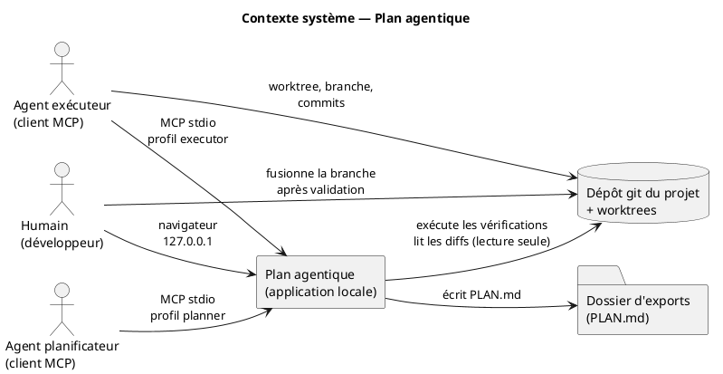

---

## 4. Déploiement local

Tout tourne sur le poste du développeur. Les serveurs MCP sont lancés **à la demande par les clients d'agents** (un processus par agent) ; le serveur Next.js est lancé par l'humain.

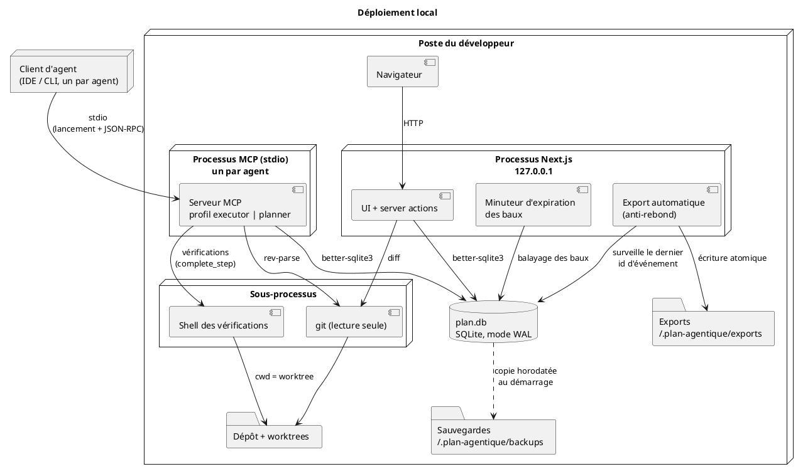

**Points à retenir**

- Aucun processus ne communique directement avec un autre : **la base est le seul point de coordination**.
- Le minuteur d'expiration et l'export automatique vivent dans le processus Next.js. Comme les événements sont écrits par d'autres processus, l'export automatique détecte les changements en **interrogeant le dernier `events.id`** plutôt que par notification en mémoire.
- L'expiration des baux est aussi **paresseuse** : évaluée à chaque `claim_step` et `get_overview`, donc correcte même si Next.js n'est pas lancé.

---

## 5. Modules et dépendances

Règle de dépendance : **les façades dépendent du noyau, le noyau ne dépend d'aucune façade**. Le noyau n'appelle l'extérieur (exécution de commandes, git, horloge, transactions) que par des **ports**, implémentés par des adaptateurs.

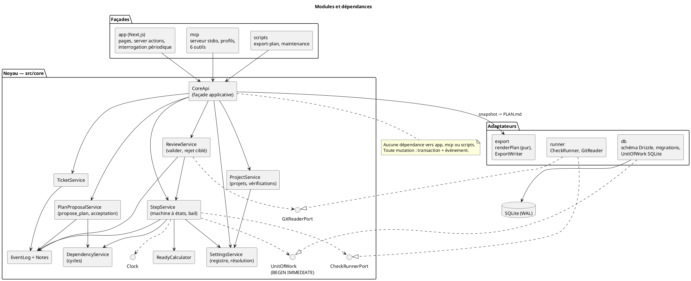

### Responsabilités

| Module | Responsabilité | Ne fait pas |
|---|---|---|
| `core/StepService` | Transitions d'étape, bail, tentatives, réclamation, clôture | Exécuter une commande (passe par `CheckRunnerPort`) |
| `core/ReadyCalculator` | Étapes prêtes (statut, ticket ouvert, dépendances satisfaites) | Écrire en base |
| `core/DependencyService` | Création de dépendances, détection de cycles, cohérence de projet | |
| `core/PlanProposalService` | `propose_plan` atomique, acceptation / rejet des propositions | Créer des vérifications |
| `core/ReviewService` | Valider un ticket, rejet ciblé avec cascade | Fusionner une branche git |
| `core/SettingsService` | Registre, validation, résolution des valeurs effectives | Exposer des réglages aux agents |
| `runner` | Exécuter les vérifications (délai, groupe de processus), lire git | Écrire dans git |
| `export` | `renderPlan` (pur) et écriture atomique | Accéder à la base |
| `mcp` | Profils, schémas zod, format de réponse, traduction d'erreurs | Règles métier |
| `app` | Écrans, server actions, interrogation périodique | Règles métier |

---

## 6. Modèle de données

Vue relationnelle simplifiée (colonnes principales). Détails complets : `SPECS.md`, section 4.

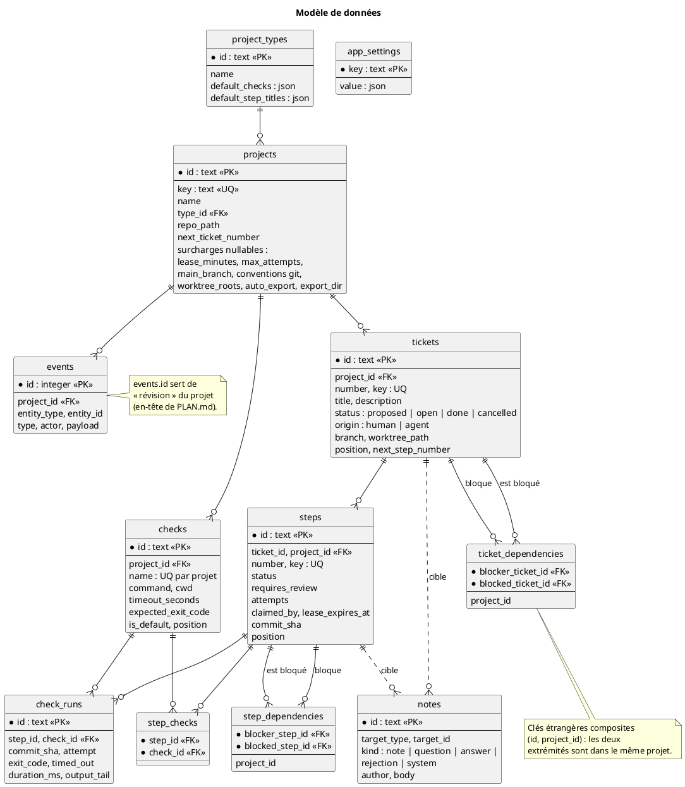

---

## 7. États : étape et ticket

### Machine à états d'une étape

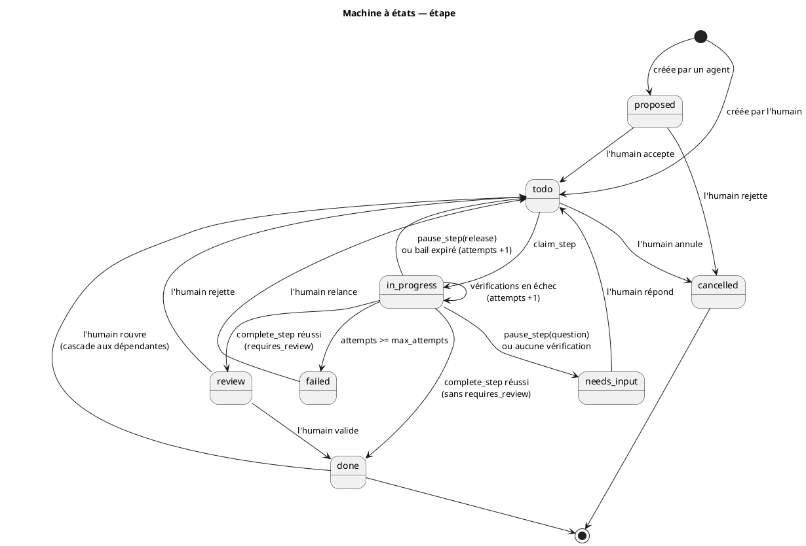

### Phase d'un ticket

Le statut stocké d'un ticket est `proposed`, `open`, `done` ou `cancelled`. Pour un ticket `open`, la **phase** est **calculée** à partir de ses étapes ; elle n'est jamais stockée.

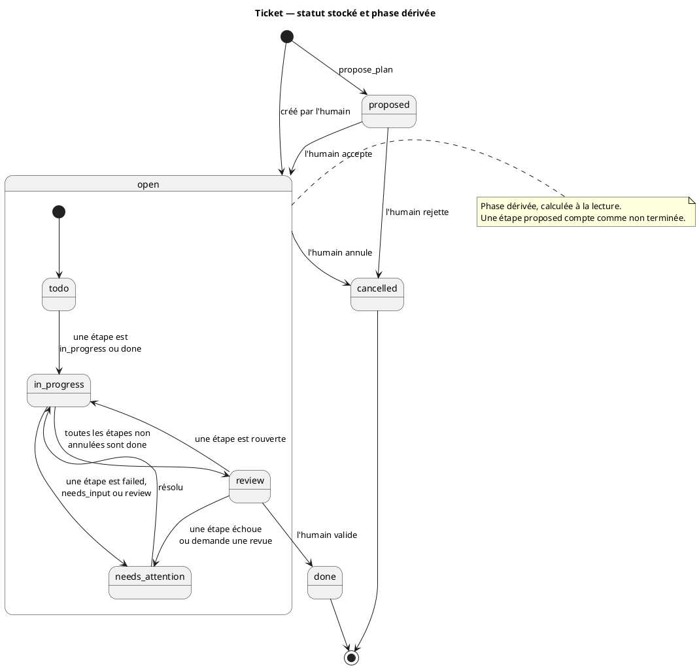

---

## 8. Scénarios dynamiques (séquences)

### 8.1 Réclamation d'une étape

Une seule transaction courte, démarrée avec `BEGIN IMMEDIATE` : deux agents concurrents ne peuvent pas obtenir la même étape.

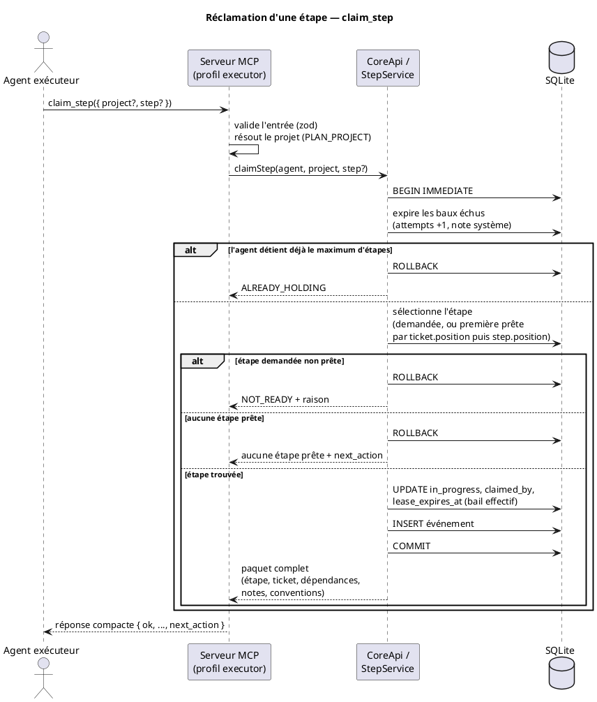

### 8.2 Clôture d'une étape et exécution des vérifications

Décision D8 : la commande s'exécute **hors de toute transaction d'écriture**. L'opération est découpée en trois temps.

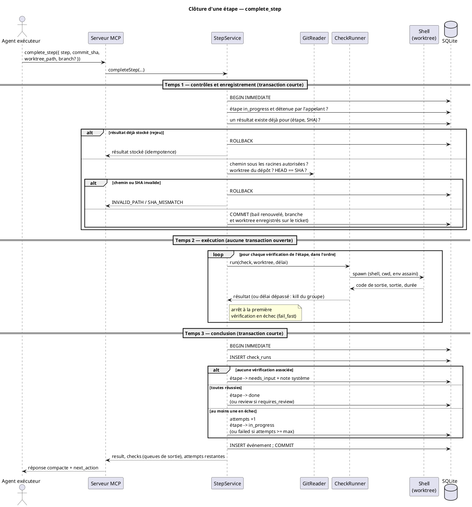

### 8.3 Planification, proposition et acceptation

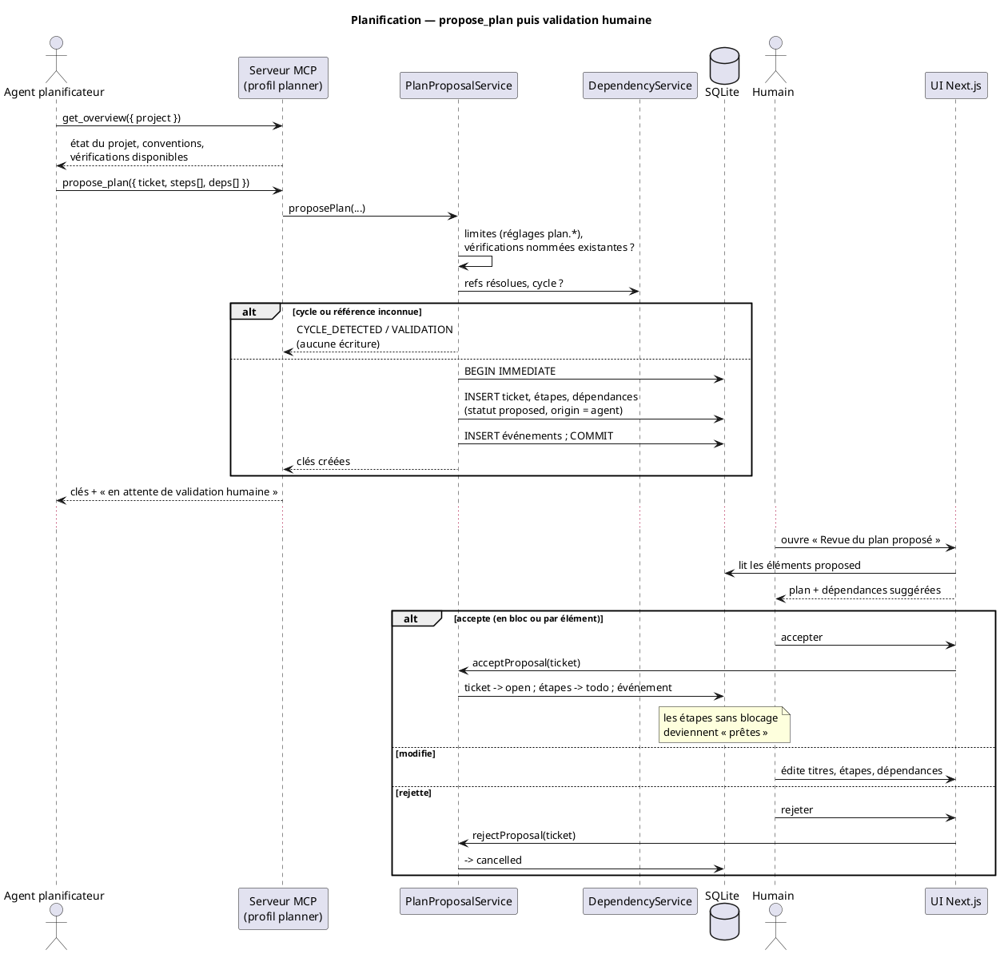

### 8.4 Revue de feature : valider ou rejeter

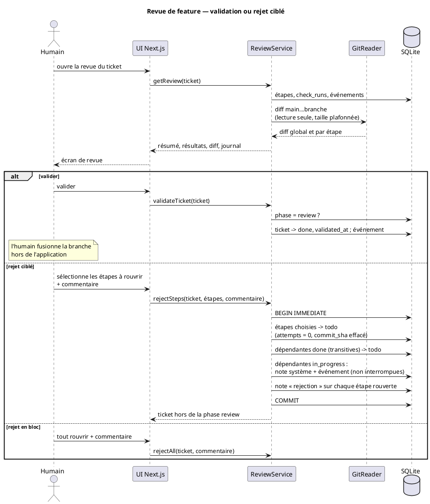

### 8.5 Export `PLAN.md`

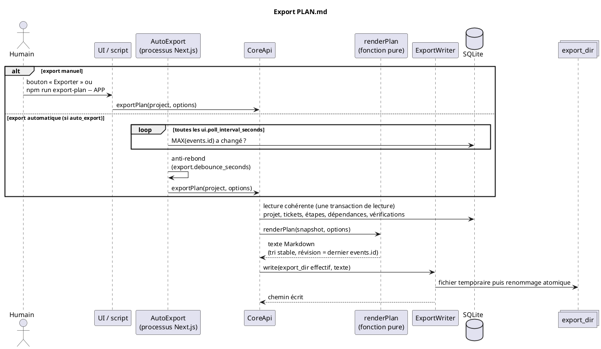

---

## 9. Règles de calcul (activités)

### 9.1 Une étape est-elle « prête » ?

`ready` n'est jamais stocké : il est calculé à chaque lecture.

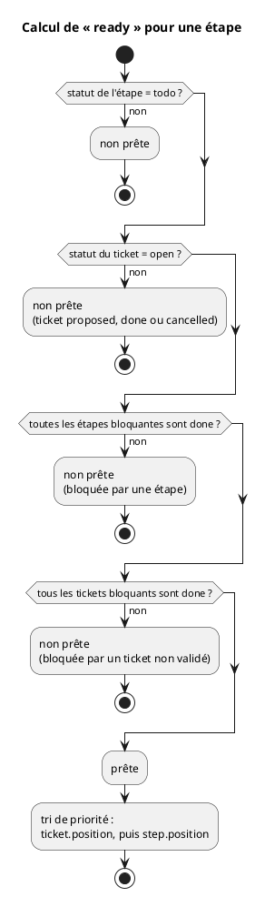

### 9.2 Résolution d'un réglage

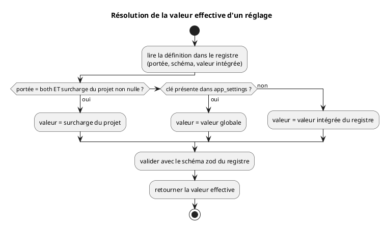

### 9.3 Création d'une dépendance

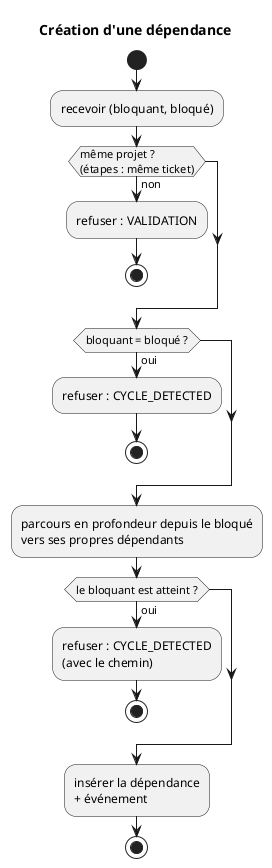

---

## 10. Concurrence et cohérence

| Sujet | Mécanisme |
|---|---|
| Accès concurrents à la base | SQLite en mode WAL, `busy_timeout`, `foreign_keys=ON` |
| Courses sur les écritures critiques | `BEGIN IMMEDIATE` pour réclamation, création de plan, transitions, rejet |
| Longues opérations | **Aucune transaction d'écriture pendant une vérification** (D8) : trois temps (enregistrer, exécuter, conclure) |
| Un seul run par worktree | Verrou en mémoire (par `realpath`) dans le processus + contrôle en base entre processus |
| Rejeu d'un appel | Idempotence de `complete_step` sur `(étape, SHA)` : le résultat stocké est renvoyé |
| Détenteur d'étape disparu | Bail avec expiration paresseuse (à chaque `claim_step` / `get_overview`) et minuteur dans Next.js |
| Intégrité des dépendances | Clés étrangères composites `(id, project_id)` ; détection de cycle dans la transaction de création |
| Cohérence de l'export | Lecture dans une seule transaction de lecture ; écriture atomique du fichier |
| Réglages modifiés en cours de route | Lus à chaque usage, pas de cache ; pas de rétroactivité sur baux et vérifications existants |
| Traçabilité | Toute mutation écrit un événement dans la même transaction |

Cas limites à couvrir par des tests : deux agents qui réclament simultanément, un serveur MCP tué pendant une vérification (le bail expire, la reprise est sûre car l'état n'a pas été modifié avant la conclusion), appels `complete_step` répétés après un délai client dépassé.

---

## 11. Frontières de confiance et sécurité

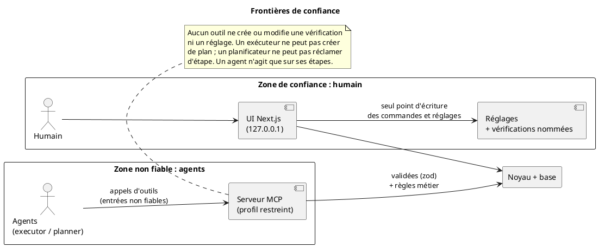

| Menace | Parade |
|---|---|
| Un agent injecte une commande arbitraire | Les tickets et étapes ne référencent que des **noms** de vérifications définies par l'humain |
| Un agent déclare des résultats faux | L'application exécute elle-même les vérifications |
| `worktree_path` malveillant | `realpath` sous les `worktree_roots`, worktree du bon dépôt, HEAD = SHA fourni |
| Injection via les noms de branche / SHA | Validation par expression régulière ; appels git par tableau d'arguments, jamais par chaîne shell |
| Fuite de secrets vers les vérifications | Environnement assaini + liste d'autorisation (`checks.env_allowlist`, réglage sensible) |
| Contenu d'agent affiché dans l'UI | Texte échappé, Markdown assaini |
| Accès réseau à l'application | Écoute sur `127.0.0.1` uniquement, non configurable |
| Un agent modifie les réglages | Aucun outil MCP n'y a accès ; modification par l'humain, confirmation pour les réglages sensibles |

---

## 12. Qualités visées et stratégie de test

| Qualité | Visée | Moyen |
|---|---|---|
| Fiabilité | Aucune étape perdue ni doublement réclamée | Transactions courtes, baux, idempotence |
| Sécurité | Aucune exécution de commande non définie par l'humain | Vérifications nommées, confinement des chemins |
| Testabilité | Règles testables sans serveur ni git réel | Noyau pur, ports remplaçables (`Clock`, `CheckRunnerPort`, `GitReaderPort`) |
| Déterminisme | Exports identiques à données identiques | `renderPlan` pur, tri stable, révision au lieu de la date |
| Observabilité | Comprendre l'historique d'une étape | Journal d'événements, `check_runs`, notes |
| Sobriété | Faible coût de contexte côté agent | 6 outils, profils, réponses compactes |
| Évolutivité | Ajouter un CLI ou un import sans toucher aux règles | Façades minces sur `CoreApi` |

**Pyramide de tests**

- *Unitaires* : machine à états, `ReadyCalculator`, détection de cycles, résolution des réglages, `renderPlan` (instantanés).
- *Intégration* : SQLite temporaire (concurrence de réclamations) ; dépôt git temporaire (runner : réussite, échec, délai, SHA différent, chemin hors racines).
- *Contrat MCP* : client MCP du SDK, liste d'outils par profil, parcours réclamer → compléter.
- *Scénarios d'acceptation* : les 18 scénarios de `SPECS.md`, section 12.

---

## 13. Risques et évolutions

| Risque | Probabilité | Atténuation |
|---|---|---|
| Contention d'écriture SQLite avec beaucoup d'agents | Faible à moyenne | Transactions très courtes, `busy_timeout`, mesure en M7 ; migration possible vers PostgreSQL derrière `UnitOfWork` |
| Dérive entre README, SPECS et code | Moyenne | SPECS comme référence, noyau unique, tests d'acceptation |
| Un agent contourne les conventions git | Moyenne | SHA vérifié, commits par étape, revue de feature avec diff |
| Vérifications trop lentes pour un appel bloquant | Moyenne | Délai configurable ; évolution possible vers un mode asynchrone (`get_step_status`) |
| Contamination d'étapes enchaînées avant la revue | Moyenne | Vérifications obligatoires, `requires_review`, rejet ciblé avec cascade |

**Évolutions prévues** (sans casser l'architecture) : CLI mince partageant `CoreApi`, import de `SPECS.md` / `PLAN.md`, vue graphe et chemin critique, mode asynchrone pour `complete_step`, sauvegarde et restauration plus complètes.

---

## 14. Générer les diagrammes

Chaque bloc ```` ```plantuml ```` est un diagramme autonome, nommé dans son `@startuml`.

- **VS Code** : extension PlantUML (aperçu `Alt+D`), ou tout éditeur compatible.
- **Ligne de commande** : Java et Graphviz installés, puis

```bash
java -jar plantuml.jar -tsvg ARCHITECTURE.md
```

PlantUML extrait les blocs `@startuml` … `@enduml` du fichier et produit un fichier par diagramme (`contexte.svg`, `deploiement.svg`, `modules.svg`, `donnees.svg`, `etats_etape.svg`, `etats_ticket.svg`, `seq_claim.svg`, `seq_complete.svg`, `seq_plan.svg`, `seq_review.svg`, `seq_export.svg`, `activite_ready.svg`, `activite_reglage.svg`, `activite_dependance.svg`, `confiance.svg`).

- **Documentation en ligne** : les rendus SVG peuvent être commités à côté du fichier et référencés depuis le README.
